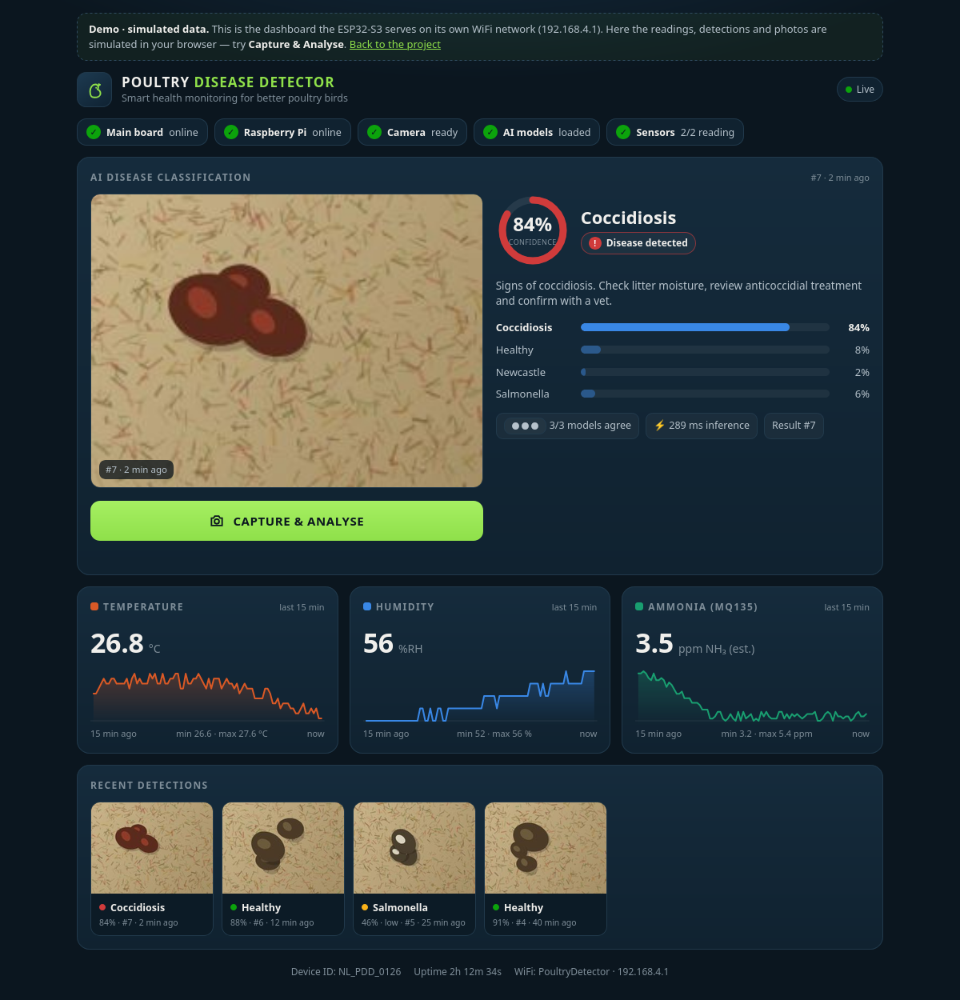
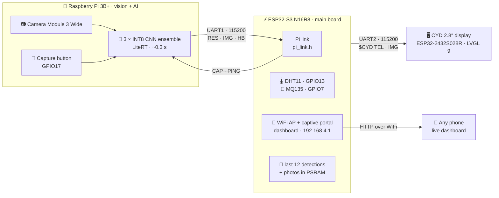
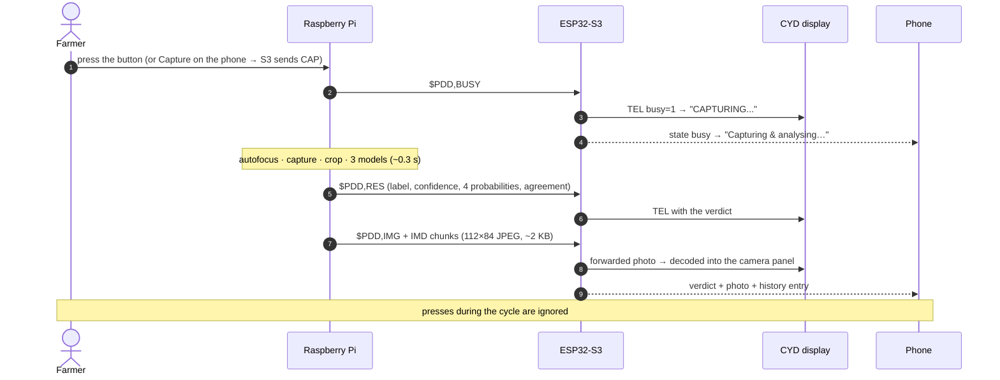
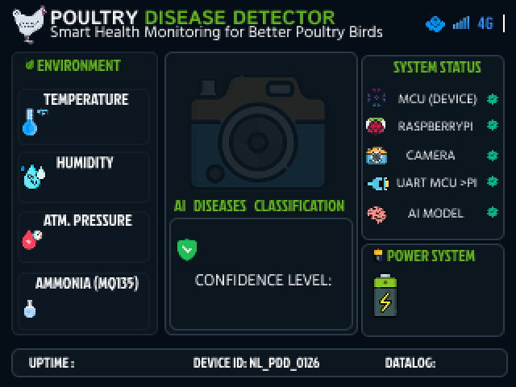
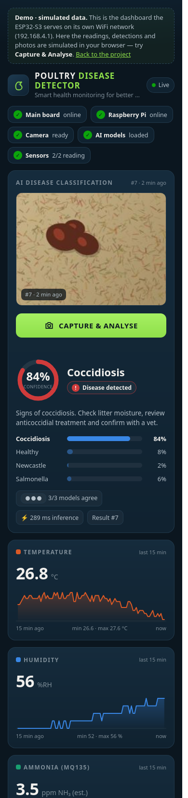

<div align="center">

# 🐔 Poultry Disease Detector

**Edge-AI that reads chicken droppings — right in the poultry house.**

A Raspberry Pi photographs the droppings and classifies them with an ensemble of three INT8 neural networks.
An ESP32-S3 main board reads the shed's temperature, humidity and ammonia, shows everything on a 2.8″ touch
display and serves a live dashboard to any phone over its own WiFi. No cloud, no internet, no app.

[](https://bigfavour51.github.io/AI_Powered-Poultry-Disease-Detector-Device/)
[](https://bigfavour51.github.io/AI_Powered-Poultry-Disease-Detector-Device/demo/)




<sub>The dashboard the ESP32-S3 serves at <code>192.168.4.1</code> (shown with the demo's simulated data and illustrative photos).</sub>

</div>

---

## Contents

- [What it does](#what-it-does)
- [System architecture](#system-architecture)
- [Detection flow](#detection-flow)
- [Hardware and wiring](#hardware-and-wiring)
- [The AI](#the-ai)
- [Displays: CYD screen and phone dashboard](#displays-cyd-screen-and-phone-dashboard)
- [Communication protocols](#communication-protocols)
- [Repository layout](#repository-layout)
- [Build, flash and deploy](#build-flash-and-deploy)
- [Reliability features](#reliability-features)
- [Roadmap](#roadmap)

---

## What it does

| | |
|---|---|
| 🔘 **One press, one verdict** | The button on the detector, the phone dashboard or the serial console starts a capture. While it runs, further presses are ignored. |
| 📷 **Photograph** | Camera Module 3 Wide (autofocus), 2304 × 1296, centre crop. |
| 🧠 **Classify** | MobileNetV2 + NASNetMobile + ShuffleNetV2 (INT8, LiteRT) vote with accuracy weights → **Coccidiosis · Healthy · Newcastle · Salmonella**. |
| 📊 **Explain** | Confidence, all four probabilities, how many models agree, a low-confidence flag (< 60 %) and a one-line advice. |
| 🌡️ **Monitor the shed** | DHT11 temperature and humidity, MQ135 ammonia estimate (calibrated in clean air). |
| 🖥️ **Show it everywhere** | 2.8″ CYD touch display next to the device, and a live dashboard on any phone that joins the device's WiFi. |
| 🔌 **Works out of the box** | Every board starts its job on power-up; the Pi service starts at boot and restarts itself on failure. |

## System architecture



Each board does one job. Both links carry plain-text frames with an NMEA-style XOR checksum, so the traffic
can be read directly in a serial monitor.

## Detection flow



## Hardware and wiring

| Part | Role |
|---|---|
| **ESP32-S3-DevKitC-1 N16R8** (16 MB flash, 8 MB octal PSRAM) | Main board: both UART links, sensors, WiFi access point, web server |
| **Raspberry Pi 3B+** | Camera, capture button, AI ensemble (`pdd.service`) |
| **Camera Module 3 Wide** (IMX708, autofocus) | Photographs the droppings |
| **ESP32-2432S028R "CYD"** 2.8″ ILI9341 + touch | Operator display (LVGL 9 + EEZ Studio UI) |
| **DHT11** | Temperature and humidity |
| **MQ135** module | Ammonia (NH₃) estimate |
| Relay module | Reserved, held off |

All logic is 3.3 V, so the links need no level shifters. The pin map avoids the ESP32-S3's strapping, flash,
octal-PSRAM and native-USB pins.

<table>
<tr><th>ESP32-S3 main board</th><th>Raspberry Pi header</th></tr>
<tr><td valign="top">

| Function | Pin | Goes to |
|---|---|---|
| Debug / flash (UART0) | GPIO43 / 44 | CH343 USB |
| Pi link TX (UART1) | GPIO17 | Pi pin 10 (RXD) |
| Pi link RX (UART1) | GPIO18 | Pi pin 8 (TXD) |
| CYD link TX (UART2) | GPIO41 | CYD GPIO35 |
| CYD link RX (UART2) | GPIO42 | CYD GPIO27 |
| DHT11 data | GPIO13 | sensor (3.3 V) |
| MQ135 AO | GPIO7 (ADC1) | module (3.3 V) |
| Relay IN | GPIO3 | held off |
| Status LED | GPIO48 | on-board RGB |
| 5V / GND | — | powers the CYD |

</td><td valign="top">

| Pin | Function |
|---|---|
| 8 | GPIO14 TXD → S3 GPIO18 |
| 10 | GPIO15 RXD ← S3 GPIO17 |
| 6 | GND (shared with the S3) |
| 11 | GPIO17 capture button |
| 9 | GND for the button |
| CSI | Camera Module 3 Wide |

</td></tr>
</table>

> [!NOTE]
> The CYD is powered from the S3's **5V** pin: its own 3.3 V regulator needs 5 V in. For the finished device use
> a 5 V / 2 A supply for the S3 side; the Pi has its own supply.

## The AI

<table>
<tr><td width="52%" valign="top">

**Validation accuracy of the INT8 models running on the Pi**

| Model | Accuracy | F1 |
|---|---:|---:|
| NASNetMobile | 88.85 % | 0.888 |
| MobileNetV2 | 88.61 % | 0.884 |
| ShuffleNetV2 | 86.75 % | 0.862 |
| **Weighted-average ensemble** | **92.76 %** | **0.925** |

The ensemble averages the three models' probabilities, weighted by their validation accuracy.

</td><td valign="top">

**Inference pipeline**

| Stage | Detail |
|---|---|
| Crop | centre square, 80 % of frame height |
| Resize | 224 × 224, nearest-neighbour |
| Scale | pixels / 255 (as in training) |
| Runtime | LiteRT, 4 threads |
| Measured | **280–297 ms** for all three on a Pi 3B+ |
| Low-confidence flag | below 60 % |

</td></tr>
</table>

> [!IMPORTANT]
> The training notebook had no separate test folder: the validation split was used both to pick the ensemble
> weights and to report accuracy, so the ensemble figure is slightly optimistic. In the original training run,
> EfficientNetB0, MobileNetV3Small and SqueezeNet collapsed to ~33 % because their built-in input scaling was
> applied to images already divided by 255; they are therefore not deployed. A corrected training run
> (each network with its own preprocessing) reached **97.8 %** with all six models — deploying it is the next step.

Training notebooks and results are kept outside this repository; the deployed `.tflite` files are not committed
(`raspberry-pi/models/` is git-ignored).

## Displays: CYD screen and phone dashboard

<table>
<tr>
<td width="50%" valign="top" align="center">
<br>
<sub><b>CYD 2.8″ display</b> — EEZ Studio layout. The firmware fills in the sensor values, verdict, confidence and
result photo, and draws live status dots (MCU, Pi, camera, UART, AI model) and the uptime.</sub>
</td>
<td width="50%" valign="top" align="center">
<br>
<sub><b>Phone dashboard</b> — join the open WiFi <code>PoultryDetector</code>; the captive portal opens the page
(or browse to <code>192.168.4.1</code>).</sub>
</td>
</tr>
</table>

**Dashboard features**

- Latest photo, verdict, confidence ring, all four class probabilities, “x/3 models agree”, inference time and advice
- **Capture & Analyse** button, locked while the Pi is busy (same as the hardware button)
- 15-minute trends for temperature, humidity and ammonia with touch tooltips
- The last 12 detections with their photos (kept in PSRAM)
- Everything is inline in the firmware: no CDN, no internet, no app

**HTTP API** (served by the ESP32-S3)

| Endpoint | Returns |
|---|---|
| `GET /` | the dashboard |
| `GET /api/state` | sensors, Pi status, last 12 detections (JSON) |
| `GET /api/history` | sensor history, one sample per 10 s, last 15 min |
| `GET /photo?seq=N` | JPEG of detection N |
| `POST /api/capture` | starts a capture (409 if busy, 503 if the Pi is offline) |

▶ **[Try the dashboard demo](https://bigfavour51.github.io/AI_Powered-Poultry-Disease-Detector-Device/demo/)** — the same page,
built from `main-board/src/web_page.h` by `tools/build_demo.py`, with the main board simulated in the browser.

## Communication protocols

Both links: 115200 8-N-1, one frame per line, `CS` = XOR of every byte between `$` and `*` as two hex digits.
Each protocol lives in one header kept identical on both ends.

**Raspberry Pi ⇄ main board** — [`pi_link.h`](main-board/lib/PiLink/pi_link.h)

| Direction | Frame | Meaning |
|---|---|---|
| Pi → S3 | `$PDD,BOOT,<ver>,<cam_ok>,<model_ok>*CS` | service started |
| Pi → S3 | `$PDD,HB,<seq>,<cam_ok>,<model_ok>,<uptime_s>*CS` | heartbeat, every 5 s |
| Pi → S3 | `$PDD,BUSY,<seq>,<BTN\|REM>*CS` | capture started |
| Pi → S3 | `$PDD,RES,<seq>,<LABEL>,<conf>,<p_cocci>,<p_healthy>,<p_ncd>,<p_salmo>,<OK\|LOW>,<agree>,<ms>*CS` | result |
| Pi → S3 | `$PDD,IMG,<seq>,<w>,<h>,<bytes>*CS` then `$PDD,IMD,<seq>,<offset>,<base64>*CS` | result photo (JPEG, 48-byte chunks) |
| Pi → S3 | `$PDD,ERR,<seq>,<CAM\|MODEL\|IMG>*CS` · `$PDD,PONG*CS` | error · ping reply |
| S3 → Pi | `$PDD,CAP*2E` · `$PDD,PING*CS` | request a capture · link check |

Example: `$PDD,RES,13,HEALTHY,91,4,91,2,3,OK,3,285*42`

**Main board → CYD display** — [`cyd_link.h`](main-board/lib/CydLink/cyd_link.h)

```
$CYD,TEL,<temp>,<hum>,<pres>,<nh3>,<batt>,<chg>,<disease>,<conf>,<seq>,<pi>,<cam>,<model>,<busy>,<uptime>*CS
$CYD,IMG,<seq>,<w>,<h>,<bytes>*CS      $CYD,IMD,<seq>,<offset>,<base64>*CS
```

A `TEL` frame goes out every 2 s and on every change; `-` means “no value” and is shown as `--`.
Example: `$CYD,TEL,26.1,49.5,-,4.4,-,0,HEALTHY,91,13,1,1,1,0,3725*71`

## Repository layout

```
.
├── main-board/        ESP32-S3 firmware (PlatformIO, Arduino)
│   ├── src/           main.cpp · web.cpp (AP, captive portal, API) · web_page.h (dashboard)
│   ├── include/       pins.h · web.h
│   └── lib/           PiLink/pi_link.h · CydLink/cyd_link.h   (shared protocol headers)
├── cyd-display/       ESP32-2432S028R firmware (PlatformIO, LVGL 9.5, EEZ Studio)
│   ├── src/ui/        generated by EEZ Studio from NL_PoultryDisease_UI.eez-project
│   └── src/           uart_driver.cpp (link + photo) · ui_manager.cpp (values, photo, status dots)
├── raspberry-pi/      camera + AI service (Python)
│   ├── pdd_inference.py   capture → preprocess → ensemble → UART frames + CSV log
│   ├── pdd.service        systemd unit (installed on the Pi)
│   ├── deploy.sh          rsync to the Pi, optionally run a command there
│   ├── stm32/             pi_link.h (copy) + Blue Pill test sketch
│   └── tests/             camera, button, UART and PC simulators
├── docs/              GitHub Pages showcase + dashboard demo
└── tools/build_demo.py    builds docs/demo/ from main-board/src/web_page.h
```

Each sub-project has a `CLAUDE.md` with its working notes.

## Build, flash and deploy

**Main board (ESP32-S3)** — plug into the board's *UART* USB port:

```bash
cd main-board
pio run -t upload          # auto-reset into the bootloader, no buttons
pio device monitor         # 115200 · commands: c capture · s status · g calibrate gas · r raw frames · ? help
```

**CYD display**:

```bash
cd cyd-display
pio run -t upload --upload-port /dev/ttyUSB0
```

**Raspberry Pi** (Raspberry Pi OS 64-bit; `enable_uart=1` and `dtoverlay=disable-bt` in `config.txt`):

```bash
cd raspberry-pi
./deploy.sh                                  # rsync to the Pi (host alias "pdd")
ssh pdd sudo systemctl restart pdd           # apply changes
ssh pdd journalctl -u pdd -f                 # follow the log
./deploy.sh venv/bin/python pdd_inference.py --benchmark 20   # time the models
```

Copy the three `*_int8.tflite` models into `raspberry-pi/models/` before the first deploy.

**Gas sensor calibration** — after 10–15 min powered in clean air, type `g` in the main-board console; R0 is
stored in flash.

**Dashboard demo** — after editing `main-board/src/web_page.h`, rebuild the demo with `python3 tools/build_demo.py`.

## Reliability features

- **Checksummed frames** on both links; bad frames are counted and dropped, stray `0x00` glitch bytes are filtered
- **One capture at a time**: button presses and remote `CAP` requests during a cycle are ignored
- **Camera watchdog**: a capture that hangs for 15 s reports `ERR,CAM` instead of freezing the service
- **Link-loss detection**: the S3 marks the Pi offline after 12 s without frames; the CYD clears stale values after 10 s
- **Auto-start**: `pdd.service` starts at boot and restarts on failure; both ESP32 boards run from flash on power-up
- **Honest displays**: a failed sensor read shows `--`, never an old value

## Roadmap

- [x] End-to-end detection: button → photo → three-model verdict → display and phone
- [x] DHT11 and MQ135 with saved calibration
- [x] Phone dashboard with captive portal, trends, history and remote capture
- [x] Auto-start on boot
- [ ] Deploy the corrected six-model ensemble (97.8 %)
- [ ] Held-out test split for an unbiased accuracy figure
- [ ] Enclosure, dedicated 5 V supply, MQ135 at 5 V with a divider
- [ ] Real-time clock and detection history kept across power cuts

---

<div align="center">
<sub>Final-year engineering project · built by <a href="https://github.com/Bigfavour51">@Bigfavour51</a> ·
PlatformIO · LVGL · TensorFlow Lite · Picamera2</sub>
</div>
